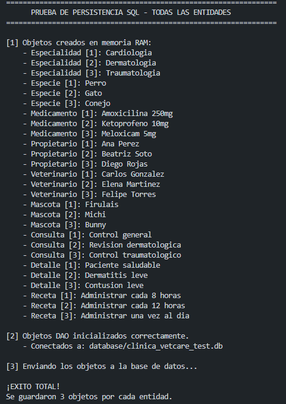
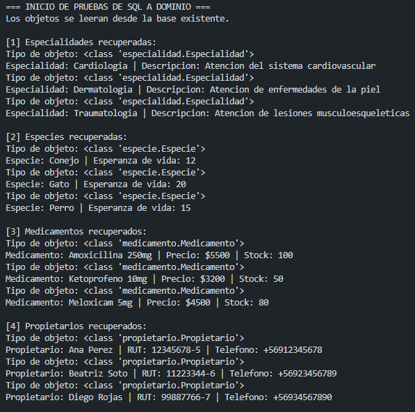
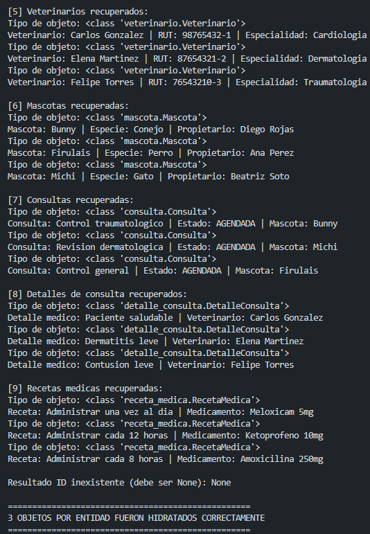
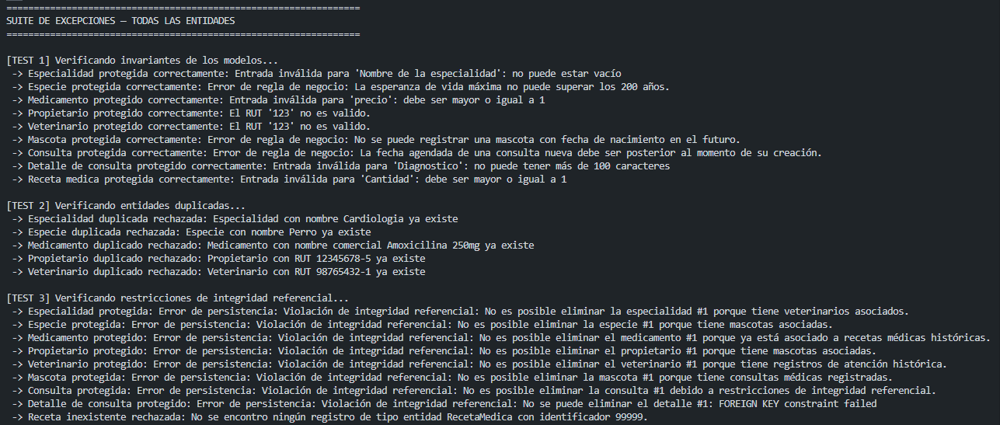
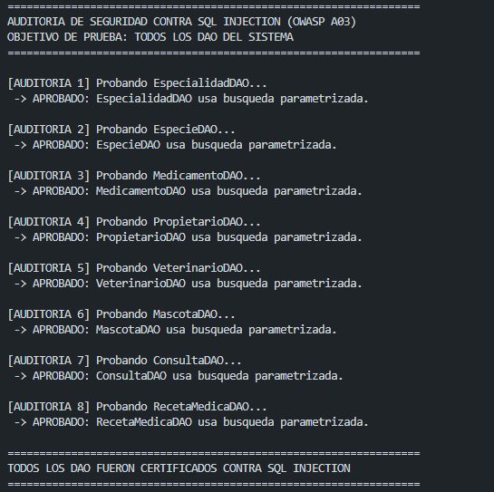

# Sistema de Gestión Clínica Veterinaria VetCare — Evaluación 3

Este proyecto implementa un sistema modular para la gestión de una clínica
veterinaria. La aplicación permite administrar propietarios, veterinarios,
especialidades, especies, mascotas, consultas, detalles de atención,
medicamentos y recetas médicas.

La solución está construida en **Python 3.11 o superior**, utiliza **SQLite3**
como motor de persistencia y sigue una arquitectura en capas. Las dependencias
externas se instalan desde `requirements.txt` dentro de un entorno virtual:

- Presentación mediante menús de consola.
- Servicios para la coordinación de la lógica de negocio.
- DAO para el acceso a datos.
- Modelos de dominio con atributos encapsulados e invariantes.
- Conexiones transaccionales con `commit`, `rollback` y claves foráneas.
- Excepciones semánticas para informar errores de dominio y persistencia.
- Pruebas ejecutables para persistencia, hidratación, resiliencia y seguridad.

---

## Índice

1. [Arquitectura del proyecto](#arquitectura-del-proyecto)
2. [Seguridad y prevención de SQL Injection](#seguridad-y-prevención-de-sql-injection)
3. [Flujo y manejo de excepciones](#flujo-y-manejo-de-excepciones)
   - [Flujo de ejecución por capas](#flujo-de-ejecución-por-capas)
4. [Requisitos e importaciones](#requisitos-e-importaciones)
5. [Estructura del repositorio](#estructura-del-repositorio)
6. [Módulos, clases y responsabilidades](#módulos-clases-y-responsabilidades)
   - [Punto de entrada](#punto-de-entrada-mainpy)
   - [Persistencia](#capa-de-persistencia-database)
   - [Modelos de dominio](#capa-de-dominio-models)
   - [Acceso a datos](#capa-de-acceso-a-datos-dao)
   - [Servicios](#capa-de-negocio-services)
   - [Presentación](#capa-de-presentación-screens)
   - [Excepciones](#módulo-de-excepciones-exceptions)
   - [Utilidades](#módulo-de-utilidades-utilities)
   - [Pruebas](#módulo-de-pruebas-tests)
7. [Guía de uso y ejecución](#guía-de-uso-y-ejecución)
8. [Reglas de negocio e invariantes](#reglas-de-negocio-e-invariantes)
9. [Uso de Inteligencia Artificial en el desarrollo](#uso-de-inteligencia-artificial-en-el-desarrollo)

---

## Arquitectura del proyecto

El sistema separa la interacción con el usuario, las reglas de negocio y la
persistencia para mantener responsabilidades claras y facilitar las pruebas.

```text
[ Presentación: screens/ ]
             |
             v
[ Servicios: services/ ]
             |
             v
[ DAO: dao/ ] <----> [ Modelos: models/ ]
             |
             v
[ Conexión y SQLite: database/ ]
             |
             v
      [ Archivos .db ]
```

### Capas

- **Presentación (`screens/`)**: muestra los menús, solicita datos y presenta
  mensajes de éxito o error. No contiene consultas SQL.
- **Servicios (`services/`)**: coordinan los DAO y los modelos. Resuelven las
  relaciones entre entidades y exponen operaciones orientadas al caso de uso.
- **DAO (`dao/`)**: encapsulan las sentencias SQL, crean las tablas necesarias,
  persisten entidades y transforman filas SQL en objetos de dominio.
- **Modelos (`models/`)**: representan las entidades del negocio. Sus
  propiedades validan los datos antes de que lleguen a la base de datos.
- **Base de datos (`database/`)**: administra conexiones SQLite con un
  context manager transaccional y activa `PRAGMA foreign_keys = ON`.
- **Pruebas (`tests/`)**: verifican la persistencia, la hidratación de objetos,
  el manejo de excepciones y la resistencia de las búsquedas ante SQL
  Injection.

### Modo de guardia

Los domingos y feriados la agenda normal permanece disponible para programar
controles futuros, pero la atención presencial se concentra en el modo de
guardia. `FeriadoService` encapsula la caché y la consulta del calendario;
`ConsultaService` aplica las reglas especiales de urgencia y mantiene el ciclo
de vida y la persistencia de todas las consultas. La pantalla de guardia
reorganiza ese flujo para registrar urgencias y reanudar pacientes que esperan
exámenes.

---

## Seguridad y prevención de SQL Injection

La aplicación utiliza consultas parametrizadas en los DAO. Los datos recibidos
desde la interfaz o desde los servicios se envían como parámetros separados de
la instrucción SQL.

### Patrón seguro utilizado

Las búsquedas parciales construyen el comodín en Python y utilizan `?` para el
valor completo:

```python
sql = """
SELECT id_medicamento, nombre_comercial, precio, stock
FROM MEDICAMENTO
WHERE nombre_comercial LIKE ?;
"""
patron = f"%{nombre}%"
cursor.execute(sql, (patron,))
```

El texto recibido no se concatena dentro de la sentencia SQL. Por lo tanto,
un payload como:

```text
' OR '1'='1
```

se interpreta como texto literal y no como una modificación de la condición
SQL.

### DAO auditados

`tests/test_seguridad_sqli.py` verifica búsquedas parametrizadas en todos los
DAO que poseen búsquedas por texto:

- `EspecialidadDAO.buscar_por_nombre`
- `EspecieDAO.buscar_por_nombre`
- `MedicamentoDAO.buscar_por_nombre`
- `PropietarioDAO.buscar_por_nombre`
- `VeterinarioDAO.buscar_por_nombre`
- `MascotaDAO.buscar_por_nombre`
- `ConsultaDAO.buscar_consultas_por_nombre_mascota`
- `RecetaMedicaDAO.buscar_por_nombre_medicamento`

Cada auditoría comprueba dos comportamientos:

1. El payload `' OR '1'='1` no devuelve todos los registros.
2. Una búsqueda legítima sí encuentra la entidad esperada.

---

## Flujo y manejo de excepciones

Las excepciones se traducen según la capa donde ocurre el problema. El
recorrido general de una operación es el siguiente:

```text
[ Usuario ingresa datos o solicita una operación ]
                         |
                         v
[ Screen ]
  Captura excepciones semánticas y muestra el mensaje.
                         |
                         v
[ Service ]
  Valida IDs, relaciones y reglas de negocio.
                         |
                         v
[ DAO ]
  Traduce errores de SQLite a excepciones del dominio.
                         |
                         v
[ ConexionDB ]
  Hace commit si todo termina correctamente.
  Hace rollback si ocurre una excepción.
```

### Flujo de ejecución por capas

El flujo comienza en `main.py`, que construye las dependencias y entrega los
servicios al menú principal. A partir de ese momento cada operación atraviesa
las capas en un orden definido:

```text
[ main.py ]
  Crea ConexionDB, los DAO y los servicios.
                         |
                         v
[ screens/menu_screen.py ]
  Muestra el menú y deriva la opción al submódulo correspondiente.
                         |
                         v
[ screens/*.py ]
  Solicita los datos, valida entradas con utilities
  y llama únicamente al servicio del caso de uso.
                         |
                         v
[ services/*.py ]
  Coordina modelos, relaciones y reglas de negocio.
                         |
                         v
[ dao/*.py ]
  Ejecuta SQL parametrizado y convierte las filas en modelos.
                         |
                         v
[ database/conexion.py ]
  Abre la conexión, activa las claves foráneas,
  confirma con commit o revierte con rollback.
                         |
                         v
[ SQLite ]
  Guarda o devuelve los registros.
```

#### Ejemplo: registrar una mascota

El flujo concreto para registrar una mascota es:

1. `main.py` crea `MascotaService` con `MascotaDAO`, `EspecieDAO` y
   `PersonaService`.
2. `menu_screen.py` deriva la opción hacia `mascotas_screen.py`.
3. `mascotas_screen.registrar_mascota` solicita RUT del propietario, nombre,
   fecha de nacimiento e ID de especie.
4. `MascotaService.registrar_mascota` obtiene la especie mediante
   `obtener_especie_por_id`, obtiene el propietario mediante
   `PersonaService.obtener_propietario_por_rut` y construye el objeto
   `Mascota`.
5. `MascotaDAO.insertar` comprueba que las relaciones tengan IDs asignados y
   ejecuta un `INSERT` con parámetros `?`.
6. `ConexionDB.obtener_conexion` confirma la transacción y el DAO asigna al
   objeto el ID generado por SQLite.
7. El servicio devuelve la mascota a la pantalla, que muestra el mensaje de
   éxito y continúa el menú.

```text
[ Usuario registra una mascota ]
              |
              v
[ mascotas_screen.registrar_mascota ]
  Lee y valida RUT, nombre, fecha e ID de especie.
              |
              v
[ MascotaService.registrar_mascota ]
  Recupera especie y propietario.
  Construye Mascota y valida sus invariantes.
              |
              v
[ MascotaDAO.insertar ]
  INSERT INTO MASCOTA (...) VALUES (?, ?, ?, ?)
              |
              v
[ ConexionDB.obtener_conexion ]
  commit() si la operación termina correctamente.
              |
              v
[ Pantalla ]
  Muestra: Mascota registrada exitosamente.
```

#### Ejemplo: consulta de una entidad inexistente

Cuando el usuario consulta un ID que no existe, el resultado no debe ser un
`traceback` visible ni una caída del menú:

```text
[ Usuario solicita la mascota con ID 99999 ]
                         |
                         v
[ mascotas_screen ]
  Llama a MascotaService.obtener_mascota_por_id(99999).
                         |
                         v
[ MascotaService ]
  Valida el ID y llama a MascotaDAO.obtener_por_id(99999).
                         |
                         v
[ MascotaDAO ]
  SELECT ... WHERE id_mascota = ?
  La fila es None.
                         |
                         v
[ MascotaDAO ]
  Lanza EntidadNoEncontradaException("Mascota", 99999).
  Ningún método de búsqueda por clave primaria retorna None de forma silenciosa.
                         |
                         v
[ Pantalla ]
  Captura la excepción, muestra el mensaje de error,
  pausa la vista y vuelve al menú.
```

Adicionalmente, las operaciones de escritura (`actualizar`, `eliminar`) retornan
un `bool` explícito que indica que la operación afectó filas
(`cursor.rowcount > 0`); si el registro no existe, el DAO lanza
`EntidadNoEncontradaException` en lugar de retornar `None`.

En una escritura, si el DAO recibe una excepción de SQLite, la conexión
ejecuta `rollback()` y el DAO la traduce a una excepción semántica, como
`EntidadExistenteException`, `ReferenciaIntegridadError` o
`PersistenciaError`. Las pantallas capturan esas excepciones y muestran el
mensaje mediante `utilities.interfaz`, de modo que el usuario puede continuar
usando la aplicación.

### Ejemplo de duplicado por clave natural

Las tablas poseen restricciones `UNIQUE`. Cuando se intenta registrar una
especialidad cuyo nombre ya existe, `EspecialidadDAO` traduce el
`sqlite3.IntegrityError` a:

```python
EntidadExistenteException(
    "Especialidad",
    especialidad.nombre_especialidad,
    "nombre"
)
```

El mensaje mostrado al usuario es:

```text
Especialidad con nombre Cardiologia ya existe
```

La excepción distingue entre duplicados por nombre, RUT, nombre comercial y
duplicados por ID dentro de las colecciones de dominio.

### Excepciones principales

- `VetCareException`: raíz de las excepciones del sistema.
- `DominioException`: base para errores propios del dominio.
- `EntradaInvalidaException`: datos que no cumplen el formato esperado.
- `RutInvalidoException`: RUT inválido.
- `NombreInvalidoException`: nombre con formato no permitido.
- `EntidadExistenteException`: colisión con una entidad o clave ya registrada.
- `EntidadNoEncontradaException`: registro que no existe.
- `ReglaNegocioError`: operación incompatible con una regla de negocio.
- `RelacionInvalidaException`: relación incorrecta entre objetos.
- `SinStockException`: cantidad solicitada superior al stock disponible.
- `PersistenciaError`: error general originado en persistencia.
- `ReferenciaIntegridadError`: operación bloqueada por una relación de clave
  foránea.

---

## Requisitos e instalación

### Requisitos del sistema

- **Python**: 3.11 o superior.
- **Entorno virtual**: recomendado para aislar las dependencias del proyecto.
- **Dependencias externas**: se encuentran en `requirements.txt`.
- **Motor de datos**: SQLite3, incluido en la biblioteca estándar de Python.
- **Sistema operativo**: compatible con Windows, Linux y macOS, siempre que se
  ejecute desde la raíz de este módulo.

### Crear el entorno virtual

Desde la raíz del repositorio:

```powershell
python -m venv venv
```

En Windows:

```powershell
.\venv\Scripts\Activate.ps1
```

En Linux o macOS:

```bash
source venv/bin/activate
```

### Instalar dependencias

Con el entorno virtual activo:

```powershell
python -m pip install --upgrade pip
python -m pip install -r requirements.txt
```

### Configurar WeatherAPI

La aplicación no incluye una clave real. Copia el ejemplo y agrega tu propia
clave de WeatherAPI en `.env`:

```powershell
Copy-Item .env.example .env
```

Edita `.env` para que contenga:

```text
WEATHER_API_KEY=tu_clave_de_weatherapi
```

El archivo `.env` está excluido de Git. No compartas ni confirmes ese archivo;
`.env.example` solo contiene el nombre de la variable. Si la clave falta o la
API no está disponible, VetCare sigue funcionando y muestra el clima como
offline.

### Biblioteca estándar utilizada

- `sqlite3`: conexión y persistencia relacional.
- `contextlib.contextmanager`: ciclo de vida transaccional de la conexión.
- `datetime`: fechas de nacimiento, fechas agendadas y estados temporales.
- `enum`: estados de las consultas.
- `typing`: anotaciones y referencias de tipos.
- `re`: validación de formatos, principalmente RUT y teléfono.
- `pathlib` y `sys`: resolución de módulos dentro del paquete de modelos.

La biblioteca estándar no requiere instalación adicional. Además, el proyecto
utiliza paquetes externos declarados en `requirements.txt`, principalmente
`requests` para consultar APIs.

---

## Estructura del repositorio

La estructura principal del repositorio es:

```text
evaluacion_3/
|
|-- README.md                         # Documentación de este proyecto
|-- main.py                           # Punto de entrada de la aplicación
|-- requirements.txt                  # Dependencias externas
|-- VetCareDominio.mmd                # Diagrama del dominio
|
|-- database/                         # Conexiones y archivos SQLite
|   |-- __init__.py
|   |-- conexion.py                   # ConexionDB y ConexionDBT
|   |-- clinica_vetcare.db            # Base principal
|   `-- clinica_vetcare_test.db       # Base utilizada por las pruebas
|
|-- models/                           # Entidades y reglas de dominio
|   |-- __init__.py
|   |-- persona.py
|   |-- propietario.py
|   |-- veterinario.py
|   |-- especialidad.py
|   |-- especie.py
|   |-- mascota.py
|   |-- consulta.py
|   |-- detalle_consulta.py
|   |-- feriado.py
|   |-- medicamento.py
|   `-- receta_medica.py
|
|-- dao/                              # Acceso a datos
|   |-- __init__.py
|   |-- especialidad_dao.py
|   |-- especie_dao.py
|   |-- medicamento_dao.py
|   |-- propietario_dao.py
|   |-- veterinario_dao.py
|   |-- mascota_dao.py
|   |-- consulta_dao.py
|   |-- feriado_dao.py
|   `-- receta_medica_dao.py
|
|-- services/                         # Lógica de aplicación
|   |-- persona_service.py
|   |-- mascota_service.py
|   |-- consulta_service.py
|   |-- economia_service.py
|   |-- feriado_service.py
|   `-- farmacia_service.py
|
|-- screens/                          # Interfaz de consola
|   |-- menu_screen.py
|   |-- propietario_screens.py
|   |-- veterinario_screens.py
|   |-- mascotas_screen.py
|   |-- consulta_screens.py
|   |-- urgencia_screen.py
|   `-- farmacia_screen.py
|
|-- exceptions/                       # Jerarquía de excepciones
|   |-- __init__.py
|   `-- exceptions.py
|
|-- utilities/                        # Validaciones, fechas e interfaz
|   |-- __init__.py
|   |-- ValidadorEntradas.py
|   |-- fechas.py
|   `-- interfaz.py
|
|-- scripts/                          # Herramientas manuales de desarrollo
|   |-- simular_feriado.py
|   `-- restaurar_dia_habil.py
|
`-- tests/                            # Pruebas ejecutables
    |-- test_persistencia_sql.py
    |-- test_sql_a_dominio.py
    |-- test_excepciones.py
    |-- test_seguridad_sqli.py
    `-- test_feriados_urgencias.py
```

Los directorios `__pycache__/` y los archivos `.pyc` son generados por Python y
no forman parte de la arquitectura funcional.

---

## Módulos, clases y responsabilidades

### Punto de entrada (`main.py`)

La función `main()` realiza la inyección manual de dependencias en el orden
necesario para respetar las relaciones entre tablas:

1. Instancia `ConexionDB`.
2. Instancia `EspecialidadDAO`, `PropietarioDAO` y `VeterinarioDAO`.
3. Instancia `EspecieDAO`, `MascotaDAO`, `MedicamentoDAO` y `DivisaDAO`.
4. Instancia `ConsultaDAO`, `RecetaMedicaDAO` y `FeriadoDAO`.
5. Instancia `PersonaService`, `MascotaService`, `EconomiaService`,
   `FeriadoService`, `ConsultaService` y `FarmaciaService`.
6. Instancia un `ClienteHTTPResiliente`, `ServicioClima` y
   `AlertaZoosanitariaService`; entrega los servicios al menú y las pantallas.

El punto de entrada también captura `KeyboardInterrupt` para terminar la
sesión de consola sin mostrar un traceback.

### Capa de persistencia (`database/`)

#### `ConexionDB`

Es la conexión utilizada por la aplicación principal. Por defecto apunta a:

```text
database/clinica_vetcare.db
```

Su context manager:

1. Abre una conexión SQLite.
2. Activa `PRAGMA foreign_keys = ON`.
3. Ejecuta `commit()` cuando el bloque termina correctamente.
4. Ejecuta `rollback()` ante una excepción.
5. Cierra siempre la conexión.

#### `ConexionDBT`

Mantiene la misma sintaxis y comportamiento transaccional de `ConexionDB`,
pero apunta por defecto a:

```text
database/clinica_vetcare_test.db
```

La base de prueba es persistente y no se elimina automáticamente. Esto permite
inspeccionar los registros después de ejecutar las pruebas. Si se necesita
reconstruirla desde cero, se debe eliminar manualmente el archivo y volver a
ejecutar la prueba de persistencia.

### Capa de dominio (`models/`)

#### `Persona`

Clase base de propietarios y veterinarios. Valida:

- ID positivo cuando ya existe.
- RUT con formato válido.
- Nombre completo alfabético.
- Teléfono con formato permitido.

#### `Propietario`

Extiende `Persona`, valida y conserva la comuna del propietario y mantiene las
mascotas asociadas. Evita agregar dos veces la misma mascota al historial en
memoria.

#### `Veterinario`

Extiende `Persona`, requiere una `Especialidad` y conserva su historial de
atenciones. Una atención solo puede registrarse si pertenece al veterinario.

#### `Especialidad`

Representa el área de atención del veterinario. Valida el nombre y limita la
longitud de la descripción.

#### `Especie`

Contiene el nombre de la especie y su esperanza de vida máxima. La esperanza
de vida debe ser un entero positivo y no puede superar los 200 años.

#### `Mascota`

Relaciona nombre, raza, fecha de nacimiento, especie y propietario. La edad se
calcula desde la fecha de nacimiento, que no puede ser futura ni superar la
esperanza de vida máxima de la especie.

#### `Consulta`

Relaciona una mascota con una fecha agendada, un motivo y un estado. Incluye
operaciones para iniciar, pausar, reanudar, cancelar, reagendar, registrar
inasistencia y finalizar una atención.

Los estados definidos por `EstadosConsulta` son:

- `AGENDADA`
- `CANCELADA`
- `NO_ASISTIO`
- `EN_ATENCION`
- `EN_ESPERA_EXAMENES`
- `FINALIZADA`

#### `DetalleConsulta`

Representa el diagnóstico, tratamiento y observaciones de una consulta y la
asocia con el veterinario responsable. Sus textos tienen límites de longitud y
solo pueden modificarse cuando la consulta se encuentra en un estado
compatible.

#### `Medicamento`

Contiene nombre comercial, precio y stock. Sus invariantes incluyen:

- Precio entero entre 1 y 100000.
- Stock entero entre 0 y 1000.
- Cantidades de reposición o descuento positivas.
- Excepción `SinStockException` cuando no hay unidades suficientes.
- Umbral de stock crítico igual a 10 unidades.

#### `Divisa`

Representa una moneda o indicador cambiario con su código, nombre, valor y
fecha de actualización. Permite convertir montos desde la divisa a pesos
chilenos y desde pesos chilenos a la divisa. Los valores USD de consultas,
medicamentos y recetas se calculan en memoria y no se persisten.

#### `Feriado`

Representa un feriado del calendario oficial mediante su fecha, nombre, tipo e
indicador de irrenunciabilidad. Sus propiedades validan los datos antes de
persistirlos y permiten que el sistema determine si una fecha corresponde a un
feriado.

#### `RecetaMedica`

Relaciona una cantidad e instrucciones con un medicamento y un detalle de
consulta. La cantidad debe ser mayor o igual a 1.

### Capa de acceso a datos (`dao/`)

Todos los DAO crean sus tablas si todavía no existen y utilizan parámetros
SQLite para los valores variables.

#### `EspecialidadDAO`

Administra la tabla `ESPECIALIDAD`:

- `insertar`
- `obtener_por_id`
- `buscar_por_nombre`
- `listar_todos`
- `actualizar`
- `eliminar`

El nombre de la especialidad es único.

#### `EspecieDAO`

Administra la tabla `ESPECIE`, con búsqueda por nombre y operaciones CRUD. El
nombre de la especie es único.

#### `MedicamentoDAO`

Administra la tabla `MEDICAMENTO`:

- `insertar`
- `obtener_por_id`
- `buscar_por_nombre`
- `listar_todos`
- `listar_stock_critico`
- `actualizar`
- `eliminar`

La tabla aplica restricciones SQL para precio positivo y stock no negativo.

#### `DivisaDAO`

Administra la tabla `DIVISA` y persiste la última cotización conocida de cada
indicador. Permite actualizar una cotización, obtenerla por código y listar
todas las divisas. La fecha almacenada permite que `EconomiaService` determine
si el valor local sigue vigente.

#### `PropietarioDAO`

Administra la tabla `PROPIETARIO`, con búsquedas por ID, RUT y nombre. El RUT
es una clave única y persiste la comuna. Si la tabla existente no tiene la
columna, la agrega conservando los registros y asigna `Los Ángeles, Chile` a
los propietarios anteriores.

#### `VeterinarioDAO`

Administra la tabla `VETERINARIO`. Requiere que la especialidad exista antes de
insertar y permite buscar por ID, RUT o nombre.

#### `MascotaDAO`

Administra la tabla `MASCOTA`. Persiste las claves foráneas de especie y
propietario, la raza y permite listar las mascotas de un propietario. Las
bases existentes reciben la columna `raza` con el valor `Sin especificar`.

#### `ConsultaDAO`

Administra dos tablas relacionadas:

- `CONSULTA`
- `DETALLE_CONSULTA`

Además de las consultas por ID, estado, mascota y veterinario, hidrata las
relaciones mascota-detalle-veterinario al recuperar los objetos.

#### `RecetaMedicaDAO`

Administra la tabla `RECETA_MEDICA`. Recupera el medicamento y el detalle de
consulta relacionados al hidratar cada receta.

#### `FeriadoDAO`

Administra las tablas `FERIADO` y `FERIADO_CACHE`. Persiste los feriados
normalizados recibidos desde la API, registra el año y mes de la caché vigente
y reconstruye objetos `Feriado` al leerlos. La caché se actualiza
mensualmente, según el alcance actual del proyecto.

### Capa de negocio (`services/`)

#### `PersonaService`

Coordina propietarios, veterinarios y especialidades. Incluye operaciones para
registrar, buscar, listar, actualizar contactos, cambiar especialidades y
eliminar entidades cuando las referencias lo permiten.

#### `MascotaService`

Coordina especies y mascotas. Obtiene las relaciones necesarias antes de
registrar una mascota y permite consultar mascotas por propietario.

#### `ConsultaService`

Coordina consultas, detalles, veterinarios, mascotas, recetas y estados de
atención. Centraliza el flujo de atención desde la agenda hasta la
finalización.

#### `EconomiaService`

Obtiene cotizaciones desde la API de DolarAPI y coordina tres niveles de
consulta: memoria RAM, caché persistente en SQLite y API externa. Valida y
transforma la respuesta, actualiza `DivisaDAO` y utiliza una cotización
histórica como contingencia cuando la API no está disponible. También expone
la conversión de montos CLP a USD.

#### `FeriadoService`

Consulta la API oficial de feriados, transforma sus respuestas en objetos
`Feriado` y sincroniza la caché mensual mediante `FeriadoDAO`. Centraliza las
reglas de calendario: identifica domingos y feriados, determina días hábiles,
autoriza urgencias únicamente en domingos o feriados y permite la contingencia
de urgencias dominicales cuando la API falla. Las consultas normales se
bloquean si no es posible verificar el calendario.

#### `ServicioClima`

Consulta las condiciones actuales de WeatherAPI mediante el cliente HTTP
resiliente inyectado. Lee `WEATHER_API_KEY` exclusivamente desde `.env`,
valida la respuesta y la transforma al modelo `Clima`; no guarda datos
climáticos ni contiene reglas veterinarias. El menú usa `Los Ángeles, Chile`
como localidad predeterminada y muestra un estado offline si la consulta falla.

#### `AlertaZoosanitariaService`

Evalúa un `Clima` y una mascota sin realizar peticiones HTTP ni acceder a la
pantalla. Las reglas iniciales son:

- Más de 28 °C: alerta de golpe de calor para perros de razas braquicéfalas
  reconocidas por el servicio.
- Menos de 8 °C: alerta preventiva para pacientes de 7 años o más, como
  criterio inicial de paciente geriátrico.
- Precipitación actual de 10 mm o más: alerta de precipitación intensa. Este
  umbral se aplica al campo `precip_mm` de la respuesta actual de WeatherAPI.

#### `FarmaciaService`

Coordina medicamentos y recetas. Permite registrar medicamentos, consultar
stock, reponer y descontar unidades, identificar stock crítico y despachar
recetas comprobando la disponibilidad.

### Capa de presentación (`screens/`)

`menu_screen.py` presenta el menú principal:

```text
1. Gestión de Propietarios
2. Gestión de Veterinarios
3. Gestión de Mascotas
4. Gestión de Consultas y Atenciones
5. Gestión de Farmacia
0. Salir
```

Los submódulos contienen los flujos de alta, consulta, búsqueda, actualización
y eliminación de cada área. Las pantallas capturan las excepciones de dominio
y las muestran mediante las funciones de `utilities.interfaz`. El encabezado
incluye el estado del clima para la sucursal de Los Ángeles, Chile. La ficha del
propietario consulta una vez el clima de su comuna y reutiliza ese resultado
para evaluar las mascotas de la ficha.

### Módulo de excepciones (`exceptions/`)

`exceptions.py` contiene la jerarquía completa de errores y
`exceptions/__init__.py` exporta las clases para que puedan utilizarse desde
las capas superiores.

Las excepciones de duplicidad aceptan el nombre del campo que produjo la
colisión. Por ejemplo, una especialidad informa `nombre`, mientras que un
propietario o veterinario informa `RUT`.

### Módulo de utilidades (`utilities/`)

- `ValidadorEntradas.py`: valida IDs, enteros, nombres, textos, RUT,
  teléfonos, fechas e instancias de dominio.
- `fechas.py`: convierte fechas y horas entre objetos Python y el formato
  almacenado por SQLite.
- `interfaz.py`: limpia la consola, muestra encabezados y mensajes, solicita
  entradas y pausa los submenús.

### Scripts auxiliares (`scripts/`)

- `simular_feriado.py`: marca la fecha actual como feriado en la base
  principal para realizar pruebas manuales del modo de guardia.
- `restaurar_dia_habil.py`: elimina el feriado simulado de la fecha actual.

Estos scripts modifican `database/clinica_vetcare.db` y no forman parte del
flujo normal de la aplicación.

### Módulo de pruebas (`tests/`)

- `test_persistencia_sql.py`: valida la inserción transaccional de registros
  para las entidades cubiertas por el script en la base de datos de pruebas
  (`ConexionDBT`), comprobando la asignación de IDs primarios y restricciones
  de integridad.
- `test_sql_a_dominio.py`: comprueba la lectura e hidratación completa de modelos desde SQLite a instancias de dominio en memoria, validando tipos de objetos y reconstrucción de relaciones navegables.
- `test_excepciones.py`: evalúa la protección ante fallas de invariantes de dominio, duplicados por clave natural (`UNIQUE`) y restricciones de integridad referencial (`FOREIGN KEY`).
- `test_seguridad_sqli.py`: audita las consultas con criterios de texto en todos los DAO contra inyecciones SQL mediante parámetros `?` y comodines parametrizados.
- `test_feriados_urgencias.py`: verifica las reglas de calendario, agenda,
  urgencias, recargos y reanudación de consultas.
- `test_servicio_clima.py`: prueba WeatherAPI con respuestas simuladas, errores,
  configuración `.env`, alertas zoosanitarias, visualización offline y
  migración/persistencia de comuna y raza. No requiere acceso a Internet.

---

## Guía de uso y ejecución

### Directorio de ejecución

Los comandos deben ejecutarse desde el directorio:

```powershell
cd evaluacion_3
```

Antes de ejecutar la aplicación, crea y activa el entorno virtual e instala
las dependencias según la sección [Requisitos e instalación](#requisitos-e-instalación).
Configura también WeatherAPI siguiendo la sección
[Configurar WeatherAPI](#configurar-weatherapi); la clave no es necesaria para
ejecutar las pruebas del servicio climático.
Los scripts deben ejecutarse como módulos para que Python encuentre
correctamente los paquetes `database`, `dao`, `models`, `services` y
`screens`.

### Ejecutar la aplicación

```powershell
python main.py
```

Para simular temporalmente que la fecha actual es feriado:

```powershell
python -m scripts.simular_feriado
python main.py
python -m scripts.restaurar_dia_habil
```

Estos scripts modifican la base principal únicamente para pruebas manuales.
Debe ejecutarse siempre `restaurar_dia_habil` al finalizar.

La aplicación abre el menú principal de VetCare y permite entrar a las cinco
áreas funcionales:

1. Propietarios.
2. Veterinarios y especialidades.
3. Mascotas y especies.
4. Consultas, atenciones, detalles y recetas.
5. Farmacia y stock.

Para ejecutar las pruebas aisladas de WeatherAPI:

```powershell
python -m unittest discover -s tests -p "test_servicio_clima.py"
```

### Flujo recomendado para las pruebas

La base de pruebas se conserva entre ejecuciones. Para obtener un escenario
limpio, elimine manualmente:

```text
database/clinica_vetcare_test.db
```

Luego ejecute nuevamente el script de persistencia.

Las pruebas son scripts ejecutables con `main()`, `print`, `assert` y
`try/except`; no requieren `pytest`. Deben ejecutarse con el entorno virtual
activo:

#### 1. Persistencia SQL

```powershell
python -m tests.test_persistencia_sql
```

Este script:

1. Crea tres objetos de cada entidad.
2. Inicializa todos los DAO con `ConexionDBT`.
3. Inserta los registros respetando las dependencias.
4. Verifica que cada objeto reciba un ID.
5. Comprueba tres filas por cada tabla principal.

El orden de inserción es:

```text
Especialidad y Especie
        |
        v
Medicamento y Propietario
        |
        v
Veterinario
        |
        v
Mascota
        |
        v
Consulta
        |
        v
DetalleConsulta
        |
        v
RecetaMedica
```

La prueba está diseñada para una base limpia. Si se ejecuta nuevamente sin
eliminar los registros previos, las restricciones `UNIQUE` pueden rechazar los
datos repetidos.

**Salida esperada:**
 Nota: Los IDs pueden variar según el estado de la base de datos

```text
=================================================================
      PRUEBA DE PERSISTENCIA SQL - TODAS LAS ENTIDADES
=================================================================

[1] Objetos creados en memoria RAM:
    - Especialidad [1]: Cardiologia
    - Especialidad [2]: Dermatologia
    - Especialidad [3]: Traumatologia
    - Especie [1]: Perro
    - Especie [2]: Gato
    - Especie [3]: Conejo
    - Medicamento [1]: Amoxicilina 250mg
    - Medicamento [2]: Ketoprofeno 10mg
    - Medicamento [3]: Meloxicam 5mg
    - Propietario [1]: Ana Perez
    - Propietario [2]: Beatriz Soto
    - Propietario [3]: Diego Rojas
    - Veterinario [1]: Carlos Gonzalez
    - Veterinario [2]: Elena Martinez
    - Veterinario [3]: Felipe Torres
    - Mascota [1]: Firulais
    - Mascota [2]: Michi
    - Mascota [3]: Bunny
    - Consulta [1]: Control general
    - Consulta [2]: Revision dermatologica
    - Consulta [3]: Control traumatologico
    - Detalle [1]: Paciente saludable
    - Detalle [2]: Dermatitis leve
    - Detalle [3]: Contusion leve
    - Receta [1]: Administrar cada 8 horas
    - Receta [2]: Administrar cada 12 horas
    - Receta [3]: Administrar una vez al dia

[2] Objetos DAO inicializados correctamente.
    - Conectados a: database/clinica_vetcare_test.db

[3] Enviando los objetos a la base de datos...

¡EXITO TOTAL!
Se guardaron 3 objetos por cada entidad.

=================================================================
```

**Resultado Obtenido:**


#### 2. SQL a dominio e hidratación

```powershell
python -m tests.test_sql_a_dominio
```

Esta prueba **no inserta datos**. Solo lee una base existente y verifica que:

- Cada fila se transforme al tipo de modelo correcto.
- Se recuperen tres objetos por cada entidad.
- Veterinarios contengan su especialidad hidratada.
- Mascotas contengan especie y propietario.
- Consultas contengan mascota y detalle.
- Detalles contengan consulta y veterinario.
- Recetas contengan medicamento y detalle.
- Un ID inexistente devuelva `None`.

Debe ejecutarse después de `test_persistencia_sql` o sobre una base que ya
contenga al menos tres registros de cada entidad.

**Salida esperada:**

```text
=== INICIO DE PRUEBAS DE SQL A DOMINIO ===
Los objetos se leeran desde la base existente.

[1] Especialidades recuperadas:
Tipo de objeto: <class 'especialidad.Especialidad'>
Especialidad: Cardiologia | Descripcion: Atencion del sistema cardiovascular
Tipo de objeto: <class 'especialidad.Especialidad'>
Especialidad: Dermatologia | Descripcion: Atencion de enfermedades de la piel
Tipo de objeto: <class 'especialidad.Especialidad'>
Especialidad: Traumatologia | Descripcion: Atencion de lesiones musculoesqueleticas

[2] Especies recuperadas:
Tipo de objeto: <class 'especie.Especie'>
Especie: Conejo | Esperanza de vida: 12
Tipo de objeto: <class 'especie.Especie'>
Especie: Gato | Esperanza de vida: 20
Tipo de objeto: <class 'especie.Especie'>
Especie: Perro | Esperanza de vida: 15

[3] Medicamentos recuperados:
Tipo de objeto: <class 'medicamento.Medicamento'>
Medicamento: Amoxicilina 250mg | Precio: $5500 | Stock: 100
Tipo de objeto: <class 'medicamento.Medicamento'>
Medicamento: Ketoprofeno 10mg | Precio: $3200 | Stock: 50
Tipo de objeto: <class 'medicamento.Medicamento'>
Medicamento: Meloxicam 5mg | Precio: $4500 | Stock: 80

[4] Propietarios recuperados:
Tipo de objeto: <class 'propietario.Propietario'>
Propietario: Ana Perez | RUT: 12345678-5 | Telefono: +56912345678
Tipo de objeto: <class 'propietario.Propietario'>
Propietario: Beatriz Soto | RUT: 11223344-6 | Telefono: +56923456789
Tipo de objeto: <class 'propietario.Propietario'>
Propietario: Diego Rojas | RUT: 99887766-7 | Telefono: +56934567890

[5] Veterinarios recuperados:
Tipo de objeto: <class 'veterinario.Veterinario'>
Veterinario: Carlos Gonzalez | RUT: 98765432-1 | Especialidad: Cardiologia
Tipo de objeto: <class 'veterinario.Veterinario'>
Veterinario: Elena Martinez | RUT: 87654321-2 | Especialidad: Dermatologia
Tipo de objeto: <class 'veterinario.Veterinario'>
Veterinario: Felipe Torres | RUT: 76543210-3 | Especialidad: Traumatologia

[6] Mascotas recuperadas:
Tipo de objeto: <class 'mascota.Mascota'>
Mascota: Bunny | Especie: Conejo | Propietario: Diego Rojas
Tipo de objeto: <class 'mascota.Mascota'>
Mascota: Firulais | Especie: Perro | Propietario: Ana Perez
Tipo de objeto: <class 'mascota.Mascota'>
Mascota: Michi | Especie: Gato | Propietario: Beatriz Soto

[7] Consultas recuperadas:
Tipo de objeto: <class 'consulta.Consulta'>
Consulta: Control traumatologico | Estado: AGENDADA | Mascota: Bunny
Tipo de objeto: <class 'consulta.Consulta'>
Consulta: Revision dermatologica | Estado: AGENDADA | Mascota: Michi
Tipo de objeto: <class 'consulta.Consulta'>
Consulta: Control general | Estado: AGENDADA | Mascota: Firulais

[8] Detalles de consulta recuperados:
Tipo de objeto: <class 'detalle_consulta.DetalleConsulta'>
Detalle medico: Paciente saludable | Veterinario: Carlos Gonzalez
Tipo de objeto: <class 'detalle_consulta.DetalleConsulta'>
Detalle medico: Dermatitis leve | Veterinario: Elena Martinez
Tipo de objeto: <class 'detalle_consulta.DetalleConsulta'>
Detalle medico: Contusion leve | Veterinario: Felipe Torres

[9] Recetas medicas recuperadas:
Tipo de objeto: <class 'receta_medica.RecetaMedica'>
Receta: Administrar una vez al dia | Medicamento: Meloxicam 5mg
Tipo de objeto: <class 'receta_medica.RecetaMedica'>
Receta: Administrar cada 12 horas | Medicamento: Ketoprofeno 10mg
Tipo de objeto: <class 'receta_medica.RecetaMedica'>
Receta: Administrar cada 8 horas | Medicamento: Amoxicilina 250mg

Resultado ID inexistente (debe ser None): None

==================================================
3 OBJETOS POR ENTIDAD FUERON HIDRATADOS CORRECTAMENTE
==================================================
```

**Resultado Obtenido:**



#### 3. Resiliencia y excepciones

```powershell
python -m tests.test_excepciones
```

La suite verifica:

- Invariantes de las entidades de dominio.
- Rechazo de especialidades, especies, medicamentos, propietarios y
  veterinarios duplicados.
- Protección de eliminaciones bloqueadas por claves foráneas.
- Rechazo de una receta inexistente.
- Reutilización de registros de preparación ya presentes en la base de prueba.

La preparación es tolerante a ejecuciones repetidas y no inserta nuevamente
los registros de ejemplo si ya existen.

**Salida esperada:**

```text
=================================================================
SUITE DE EXCEPCIONES — TODAS LAS ENTIDADES
=================================================================

[TEST 1] Verificando invariantes de los modelos...
 -> Especialidad protegida correctamente: Entrada inválida para 'Nombre de la especialidad': no puede estar vacío
 -> Especie protegida correctamente: Error de regla de negocio: La esperanza de vida máxima no puede superar los 200 años.
 -> Medicamento protegido correctamente: Entrada inválida para 'precio': debe ser mayor o igual a 1
 -> Propietario protegido correctamente: El RUT '123' no es valido.
 -> Veterinario protegido correctamente: El RUT '123' no es valido.
 -> Mascota protegida correctamente: Error de regla de negocio: No se puede registrar una mascota con fecha de nacimiento en el futuro.
 -> Consulta protegida correctamente: Error de regla de negocio: La fecha agendada de una consulta nueva debe ser posterior al momento de su creación.
 -> Detalle de consulta protegido correctamente: Entrada inválida para 'Diagnostico': no puede tener más de 100 caracteres
 -> Receta medica protegida correctamente: Entrada inválida para 'Cantidad': debe ser mayor o igual a 1

[TEST 2] Verificando entidades duplicadas...
 -> Especialidad duplicada rechazada: Especialidad con nombre Cardiologia ya existe
 -> Especie duplicada rechazada: Especie con nombre Perro ya existe
 -> Medicamento duplicado rechazado: Medicamento con nombre comercial Amoxicilina 250mg ya existe
 -> Propietario duplicado rechazado: Propietario con RUT 12345678-5 ya existe
 -> Veterinario duplicado rechazado: Veterinario con RUT 98765432-1 ya existe

[TEST 3] Verificando restricciones de integridad referencial...
 -> Especialidad protegida: Error de persistencia: Violación de integridad referencial: No es posible eliminar la especialidad #1 porque tiene veterinarios asociados.
 -> Especie protegida: Error de persistencia: Violación de integridad referencial: No es posible eliminar la especie #1 porque tiene mascotas asociadas.
 -> Medicamento protegido: Error de persistencia: Violación de integridad referencial: No es posible eliminar el medicamento #1 porque ya está asociado a recetas médicas históricas.
 -> Propietario protegido: Error de persistencia: Violación de integridad referencial: No es posible eliminar el propietario #1 porque tiene mascotas asociadas.
 -> Veterinario protegido: Error de persistencia: Violación de integridad referencial: No es posible eliminar el veterinario #1 porque tiene registros de atención histórica.
 -> Mascota protegida: Error de persistencia: Violación de integridad referencial: No es posible eliminar la mascota #1 porque tiene consultas médicas registradas.
 -> Consulta protegida: Error de persistencia: Violación de integridad referencial: No es posible eliminar la consulta #1 debido a restricciones de integridad referencial.
 -> Detalle de consulta protegido: Error de persistencia: Violación de integridad referencial: No se puede eliminar el detalle #1: FOREIGN KEY constraint failed
 -> Receta inexistente rechazada: No se encontro ningún registro de tipo entidad RecetaMedica con identificador 99999.

=================================================================
[EXITO] TODAS LAS PRUEBAS DE EXCEPCIONES PASARON CON EXITO
=================================================================
```

**Resultado Obtenido:**


#### 4. Auditoría contra SQL Injection

```powershell
python -m tests.test_seguridad_sqli
```

La auditoría utiliza el payload:

```text
' OR '1'='1
```

y valida que los ocho DAO con búsquedas de texto:

- no alteren la consulta;
- no devuelvan todos los registros;
- sigan funcionando con búsquedas legítimas.

Este script prepara registros de prueba mediante `ConexionDBT`. Si esos
registros ya existen, se recomienda reconstruir manualmente la base de prueba
antes de ejecutarlo.

**Salida esperada:**

```text
=================================================================
AUDITORIA DE SEGURIDAD CONTRA SQL INJECTION (OWASP A03)
OBJETIVO DE PRUEBA: TODOS LOS DAO DEL SISTEMA
=================================================================

[AUDITORIA 1] Probando EspecialidadDAO...
 -> APROBADO: EspecialidadDAO usa busqueda parametrizada.

[AUDITORIA 2] Probando EspecieDAO...
 -> APROBADO: EspecieDAO usa busqueda parametrizada.

[AUDITORIA 3] Probando MedicamentoDAO...
 -> APROBADO: MedicamentoDAO usa busqueda parametrizada.

[AUDITORIA 4] Probando PropietarioDAO...
 -> APROBADO: PropietarioDAO usa busqueda parametrizada.

[AUDITORIA 5] Probando VeterinarioDAO...
 -> APROBADO: VeterinarioDAO usa busqueda parametrizada.

[AUDITORIA 6] Probando MascotaDAO...
 -> APROBADO: MascotaDAO usa busqueda parametrizada.

[AUDITORIA 7] Probando ConsultaDAO...
 -> APROBADO: ConsultaDAO usa busqueda parametrizada.

[AUDITORIA 8] Probando RecetaMedicaDAO...
 -> APROBADO: RecetaMedicaDAO usa busqueda parametrizada.

=================================================================
TODOS LOS DAO FUERON CERTIFICADOS CONTRA SQL INJECTION
=================================================================
```

**Resultado Obtenido:**


### Forma de ejecución de los scripts

Los archivos de `tests/` son scripts ejecutables con `main()`, `print`,
`assert` y `try/except`. No dependen de `pytest` ni de fixtures externos.

---

## Reglas de negocio e invariantes

1. **IDs positivos y no reasignables**: los DAO asignan el ID generado por
   SQLite y los modelos rechazan una segunda asignación.
2. **Especialidades únicas**: no se permite repetir el nombre de una
   especialidad.
3. **Especies únicas**: no se permite repetir el nombre de una especie.
4. **RUT único**: propietarios y veterinarios no pueden compartir RUT.
5. **Medicamentos únicos**: el nombre comercial identifica de forma única al
   medicamento.
6. **Precios y stock válidos**: el precio debe ser positivo y el stock no
   puede ser negativo.
7. **Stock crítico**: un medicamento se considera crítico cuando tiene 10 o
   menos unidades.
8. **Fechas válidas**: una mascota no puede nacer en el futuro ni superar la
   expectativa de vida de su especie.
9. **Consultas futuras**: una consulta nueva debe agendarse después del
   momento actual.
10. **Estados controlados**: una consulta solo puede cambiar de estado si la
    transición está permitida por el modelo.
11. **Relaciones obligatorias**: una mascota requiere especie y propietario;
    una consulta requiere mascota; un detalle requiere consulta y veterinario; veterinario requiere especialidad;
    una receta requiere medicamento y detalle.
12. **Integridad referencial**: no se eliminan entidades que todavía tienen
    registros dependientes.
13. **Transacciones atómicas**: cada operación de conexión confirma o revierte
    sus cambios como una unidad.
14. **Consultas parametrizadas**: los valores externos nunca se interpolan
    directamente dentro de una sentencia SQL.
15. **Hidratación completa**: los DAO reconstruyen las relaciones de dominio al
    leer las filas almacenadas.
16. **Calendario laboral**: las consultas normales solo pueden agendarse y
    comenzar en días hábiles; el sábado es laborable y el domingo no lo es.
17. **Atenciones de urgencia**: las urgencias se registran directamente en
    estado `EN_ATENCION`, con la misma fecha de agenda e inicio de atención,
    y solo se permiten en domingos o feriados.
18. **Recargos históricos**: el porcentaje de recargo y el monto total quedan
    almacenados en la consulta; los equivalentes en USD solo existen en
    memoria.
19. **Caché de feriados**: la caché del calendario oficial se mantiene por
    mes en SQLite y se reemplaza cuando deja de corresponder al mes actual.

---

## Resultado esperado

Cuando la base de prueba contiene los registros necesarios, el flujo completo
es:

```text
Persistencia SQL: 3 objetos por entidad guardados
                    |
                    v
SQL a dominio: objetos y relaciones hidratados
                    |
                    v
Excepciones: invariantes e integridad referencial protegidas
                    |
                    v
SQL Injection: búsquedas parametrizadas certificadas
```

La documentación de este archivo corresponde a la implementación de
`evaluacion_3` por Tomás Soto Y Francisco Calquín.

---

## Uso de Inteligencia Artificial en el desarrollo

Durante el ciclo de vida del desarrollo de la solución, se incorporaron herramientas de Inteligencia Artificial y agentes de asistencia técnica en tareas específicas de ingeniería de software y arquitectura:

1. **Configuración y gestión de paquetes (`__init__.py`)**:
   - Automatización y estructuración de los archivos de inicialización en las diferentes capas (`models/`, `dao/`, `services/`, `screens/`, `database/`, `exceptions/`, `utilities/`).
   - Definición explícita de símbolos exportables mediante `__all__`, encapsulando implementaciones internas y facilitando una interfaz limpia para el consumo entre módulos.

2. **Resolución y prevención de dependencias e importaciones circulares**:
   - Análisis estático del grafo de dependencias entre modelos interrelacionados (por ejemplo, `Consulta`, `DetalleConsulta`, `Mascota`, `Veterinario` y `RecetaMedica`).
   - Aplicación de buenas prácticas de desacoplamiento arquitectónico, recurriendo a inyección de dependencias en servicios, uso de `typing.TYPE_CHECKING` con anotaciones diferidas y resolución de referencias en tiempo de ejecución para evitar bloqueos en el cargador de módulos de Python.

3. **Diseño y estructuración técnica del README**:
   - Redacción, ordenamiento y estandarización de la documentación técnica y del índice general.
   - Creación de diagramas de arquitectura en capas, flujos de ejecución y especificación formal de contratos, invariantes y reglas de negocio del sistema.

4. **Validación del flujo del sistema mediante agentes de asistencia**:
   - Simulación y trazabilidad integral del ciclo de ejecución por capas (desde la entrada del usuario en consola, pasando por la orquestación en servicios y validaciones de dominio, hasta las operaciones transaccionales y de hidratación en los DAO).
   - Verificación de la consistencia en el manejo de transacciones (`commit`/`rollback`) y control semántico de excepciones ante entradas inválidas o colisiones de integridad relacional.

5. **Diseño y cobertura de la suite de pruebas**:
   - Estructuración metodológica de los scripts ejecutables en `tests/`: pruebas de persistencia multientidad (`test_persistencia_sql.py`), verificación de hidratación y reconstrucción de grafos de objetos (`test_sql_a_dominio.py`), suite de resiliencia e invariantes (`test_excepciones.py`) y auditorías de seguridad contra inyección SQL parametrizada (`test_seguridad_sqli.py`).
   - Definición de casos de prueba de borde para validar restricciones `UNIQUE`, integridad referencial con claves foráneas activas y verificación de payloads maliciosos según lineamientos OWASP.

6. **Optimización y resiliencia en el consumo de APIs externas mediante caché multinivel**:
   - Diseño e implementación del patrón *Read-Through / Multilevel Cache* (L1 en memoria RAM y L2 persistente en SQLite) en `EconomiaService` para la consulta y conversión de divisas.
   - Definición de una política de invalidación basada en fechas hábiles del mercado financiero (`date.today()` y retroceso a viernes durante fines de semana) para suprimir peticiones HTTP redundantes, eliminando la latencia en las vistas de catálogo y previniendo bloqueos por *rate limiting* de la API externa.
   - Enriquecimiento volátil en memoria RAM para medicamentos y recetas médicas en `FarmaciaService`, permitiendo valorizaciones bimonetarias (`CLP` y `USD`) en tiempo real durante la consulta de catálogo y el flujo transaccional de ventas sin alterar el esquema relacional en SQLite.
   - Implementación de un mecanismo de contingencia degradada (*fallback offline*), garantizando la continuidad operativa del sistema mediante el uso de la última cotización histórica almacenada en SQLite ante caídas de red, fallos de conectividad o indisponibilidad del servicio remoto.

7. **Evaluación de alternativas para la caché de feriados**:
   - Se utilizó IA para analizar e intentar diseñar una persistencia local de los
     feriados mediante archivos JSON, incluyendo su lectura, escritura y
     actualización como caché.
   - Esta alternativa fue descartada porque el manejo y acceso de archivos JSON
     todavía excedía los conocimientos actuales del equipo y no era necesario
     para el alcance académico del proyecto.
   - Finalmente, la caché de feriados se implementó en SQLite, tecnología ya
     utilizada y comprendida dentro del proyecto.
